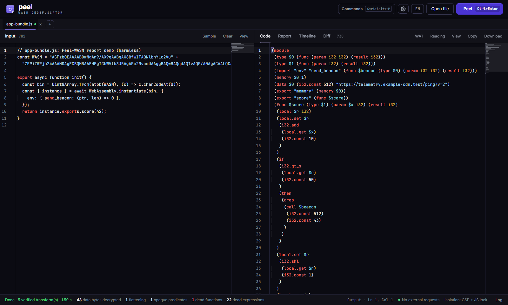
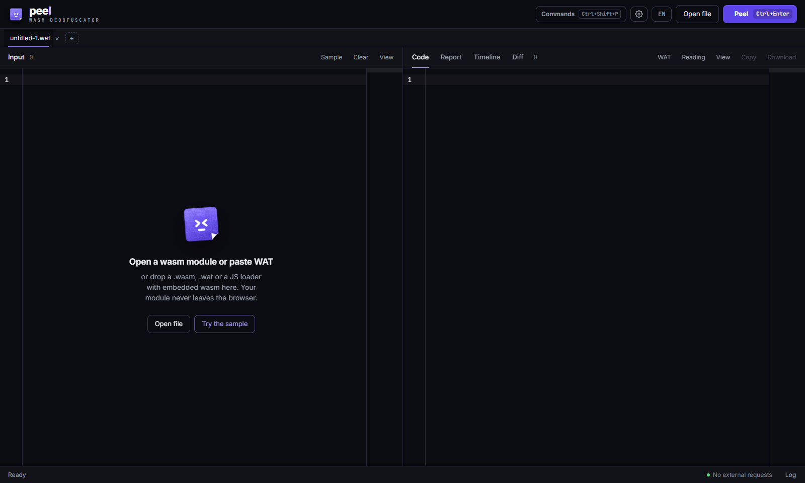
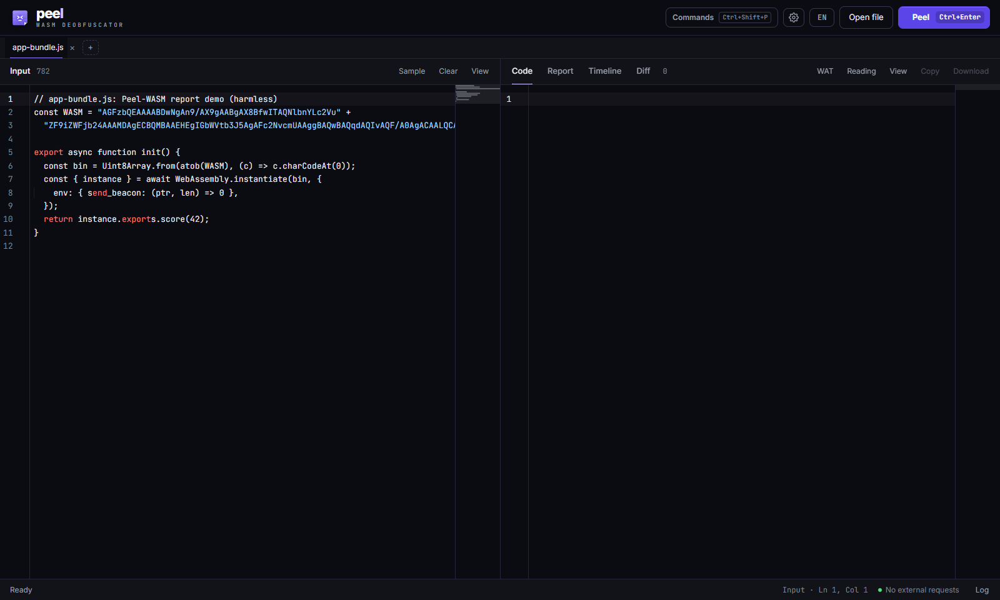
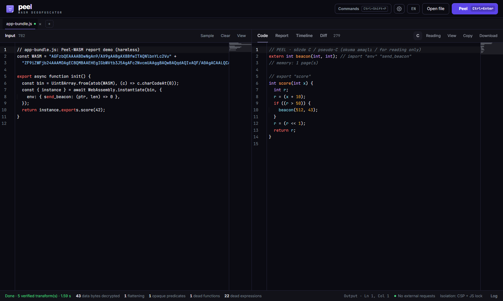
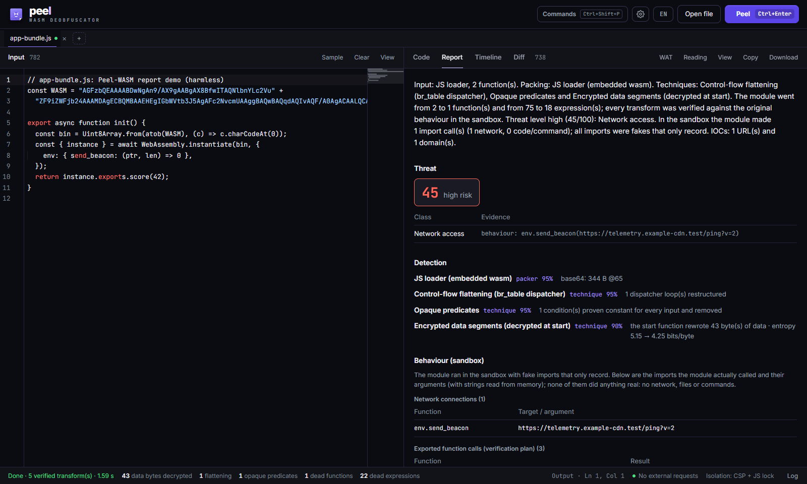
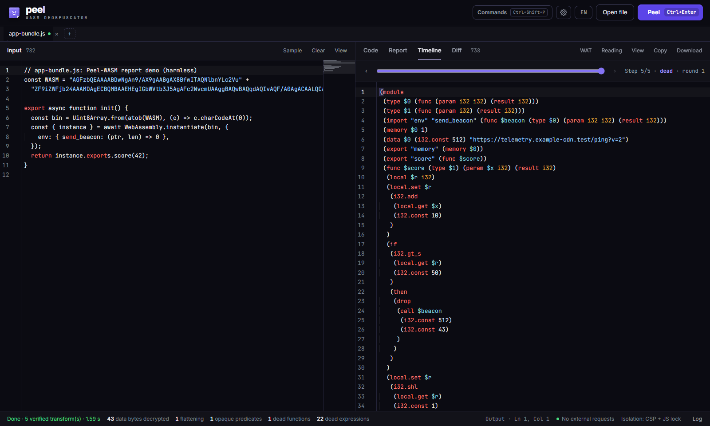
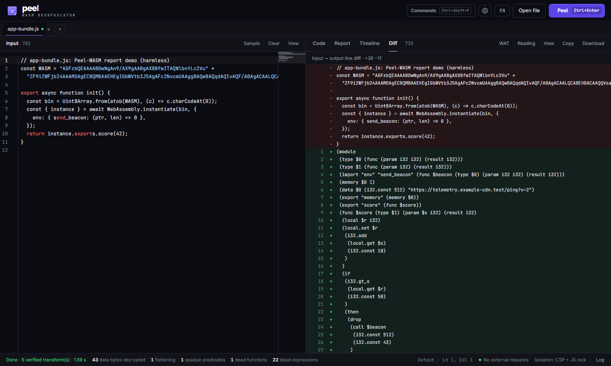
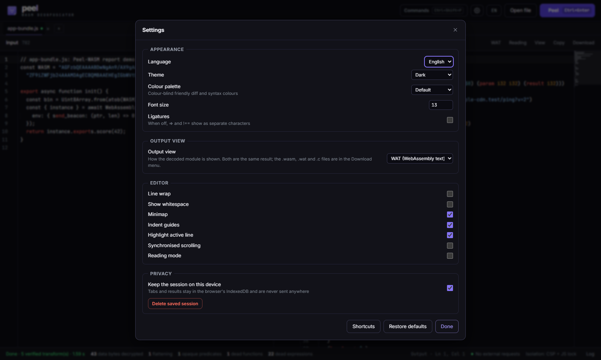
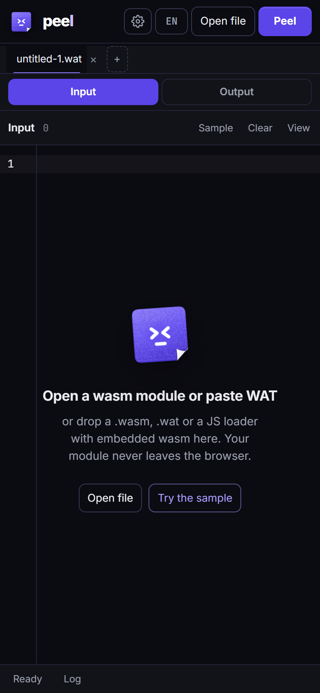
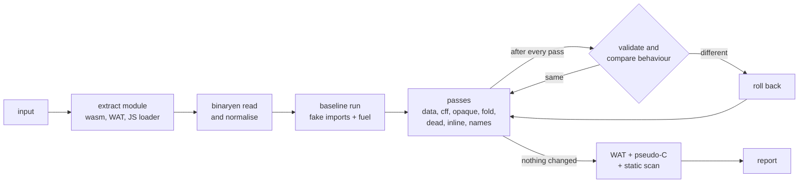

<p align="center">
  <picture>
    <source media="(prefers-color-scheme: dark)" srcset="public/peel-logo-horizontal-dark-1600.png">
    
  </picture>
</p>

<p align="center">
  <b>Peel the obfuscation off WebAssembly, right in your browser.</b><br>
  Open source · MIT · free forever · your module never leaves your device
</p>

<p align="center">
  <a href="README.tr.md">Türkçe</a> ·
  <a href="#quick-start">Quick start</a> ·
  <a href="#what-it-undoes">What it undoes</a> ·
  <a href="#analysis-report">Report</a> ·
  <a href="#command-line">CLI</a> ·
  <a href="#library">Library</a> ·
  <a href="#how-it-works">How it works</a> ·
  <a href="#honest-limits">Limits</a>
</p>

<p align="center">
  
</p>

---

## What is PEEL?

PEEL is a WebAssembly deobfuscator and analyser. Open a `.wasm` file, paste WAT, or drop the JavaScript loader that carries
the module as base64, press **Peel** (`Ctrl + Enter`), and you get a readable module back as WAT or pseudo-C, plus a report of
what the module actually does.

- **It runs the module, safely.** The module is instantiated with fake imports only: every import records its call and
  arguments (and the strings they point to in memory) and does nothing else. There is no network, no file system and no
  JavaScript reachable from the module. A fuel counter stops infinite loops, a watchdog kills a hung worker or process.
- **It proves its own changes.** After every transform the module is validated and run again. The exported functions are
  called with fixed arguments; if any return value or trap, any recorded import call, the memory hash or an exported global
  differs from the original, the transform is rolled back.
- **It tells you what the module does.** Toolchain (Emscripten, Rust / wasm-bindgen, Go, TinyGo, AssemblyScript, .NET,
  clang / wasi-sdk), obfuscation techniques with evidence, cryptominer signatures (CryptoNight, RandomX), the imports the module
  really called, console output, IOCs (URLs, domains, IPs, mining pools, Monero wallets, Discord webhooks) and a threat score.
- **It stays on your machine.** No server, no upload, no telemetry. The status bar counts every external request the page makes.

One button runs everything.

## Scope

| Input | How it is handled |
|---|---|
| `.wasm` binary | read directly; shown as WAT in the input editor, but the original bytes are what gets peeled |
| `.wat` / `.wast` text | parsed with binaryen |
| JavaScript / HTML loader | the embedded module is extracted: base64 (also split across `"…" + "…"`), `data:application/wasm` URLs, byte arrays (`new Uint8Array([0, 97, 115, 109, …])`), `\x00\x61…` strings and hex strings; every module found is listed as a layer, the largest is peeled |
| plain base64 | decoded |

Output: the cleaned module as `.wasm`, its WAT text, and a wasm-decompile style pseudo-C view.

## Quick start

You need Node.js 25 or newer (the CLI sandbox uses Node's permission model).

```bash
git clone https://github.com/ForgeLLC/Peel-WASM.git
cd Peel-WASM
npm install
npm run dev
```

Open <http://localhost:5173>, drop a `.wasm`, `.wat` or `.js` file onto the page or click **Try the sample**, then press **Peel**.
The first run loads binaryen.js from the same origin (about 15 MB, cached afterwards).

```bash
npm run build
```

`dist/` is the whole app as static files, including `dist/vendor/binaryen.js` with its licence and a `_headers` file with the
sandbox CSP for Netlify and Cloudflare Pages. After the first visit it also works offline as a PWA.

## Screenshots

<table>
  <tr>
    <td width="50%"><br><sub><b>Start screen.</b> Open a file or a folder, drop one, or try the sample.</sub></td>
    <td width="50%"><br><sub><b>Input.</b> A JS loader carrying the module as base64.</sub></td>
  </tr>
  <tr>
    <td><br><sub><b>WAT.</b> Data decrypted, dispatcher restructured, opaque predicate and dead code gone.</sub></td>
    <td><br><sub><b>Pseudo-C.</b> The same result in a wasm-decompile style view.</sub></td>
  </tr>
  <tr>
    <td><br><sub><b>Report.</b> Summary, threat, detections, the imports the module really called, IOCs, metrics.</sub></td>
    <td><br><sub><b>Timeline.</b> The module after every accepted transform.</sub></td>
  </tr>
  <tr>
    <td><br><sub><b>Diff.</b> Input against output.</sub></td>
    <td><br><sub><b>Settings.</b> Language, theme, colour-blind palettes, output view, editor and session options.</sub></td>
  </tr>
</table>

<p align="center">
  <br>
  <sub>The interface also works on a phone.</sub>
</p>

The demo in these screenshots is harmless: a JS loader whose module decrypts a URL in its start function, hides one function
behind a `br_table` dispatcher with an opaque predicate, and passes the URL to an `env.send_beacon` import. Nothing was sent:
the import was a recorder, which is why the call shows up in the report.

## What it undoes

Every transform below is verified against the original behaviour and rolled back on any difference.

| Pass | Obfuscation | How |
|---|---|---|
| `data` | data segments encrypted on disk and decrypted by the start function | the module is instantiated in the sandbox, the memory right after `start` becomes the new data segments, `start` is removed |
| `cff` | control-flow flattening: a `loop` + `br_table` dispatcher on a state local (also `xor`/`add`-encoded states) | every state's code and successor (constant, `select`/`if` choice, fall-through, return, outer exit) is read and the graph is rebuilt into structured `if`/`loop` with binaryen's Relooper |
| `opaque` | opaque predicates such as `x*(x+1)` is even, `7y²-1 ≠ x²`, `(x\|1) ≠ 0`, `x² mod 4 ≠ 2` | the condition is proven constant over every input by exhaustive evaluation of the low bits it depends on (sound for add/sub/mul/shl/and/or/xor), then the dead branch is removed |
| `fold` | constant encoding (`i32.xor (const a) (const b)`, constants hidden in immutable globals) | binaryen precompute, optimize-instructions, simplify-globals |
| `dead` | junk branches and functions nothing calls | binaryen dce, vacuum, remove-unused-module-elements |
| `inline` | function splitting (a body cut into fragments, each called once) | binaryen inlining of single-caller fragments, only when fragments are a large share of the module |
| `names` | stripped name section | functions and globals are named after their exports and imports, the start function and the shadow stack pointer, written to a real `name` section |

Not decoded, only reported:

- **VM-based protection.** A loop that dispatches an opcode read from memory into a large `br_table` is reported as a bytecode
  interpreter; together with other obfuscation it is reported as VM protection. The bytecode is not translated back to wasm.
  The surrounding wasm is still peeled. (A legitimate interpreter has the same shape; the report says so.)
- **Embedded second-stage modules** in data segments or handed to an import at runtime are listed as layers with their sizes.

## Analysis report

- **Detection** with confidence and evidence: toolchain, packer (JS loader, embedded module), techniques, cryptominer.
- **Cryptominer signatures**: Keccak round constants, AES S-box / T-tables, the CryptoNight scratchpad masks
  (`0x1FFFF0`, lite and heavy variants), Blake2b / Skein / Groestl constants, RandomX and miner strings. One signal is not enough;
  the report needs several.
- **Behaviour**: the imports the module actually called in the sandbox, with arguments and the strings they point to, grouped
  into network, code/command, file and other; console output written through WASI `fd_write`; the results of the exported calls
  used for verification.
- **IOCs**: URLs, domains, IPs, e-mails, `stratum+tcp://` pools, Monero wallets, Discord webhooks, Telegram bots.
- **Threat score** (0 to 100) with classes such as cryptojacking, dynamic code (`eval`, `emscripten_run_script`), network
  access, exfiltration and second-stage loading.
- **Metrics**: size, functions and expressions before and after, layers, rounds, rollbacks.
- A one-paragraph summary in Turkish or English.

## Command line

```bash
npx peel-wasm module.wasm                     # WAT to stdout, summary to stderr
npx peel-wasm module.wasm -o clean.wasm --c clean.c -r report.json
npx peel-wasm bundle.js -f c                  # extract from a JS loader, pseudo-C to stdout
npx peel-wasm samples/ -d out/ --json --fail-on high
cat module.wasm | npx peel-wasm - -r text --lang en
```

| Option | |
|---|---|
| `-o, --out <file>` | write the result; the format comes from the extension (`.wasm`, `.wat`, `.c`) |
| `--wat <file>`, `--c <file>` | also write WAT / pseudo-C |
| `-f, --format wat\|c\|wasm` | format for stdout and `-d` |
| `-d, --out-dir <dir>` | write `<name>.peeled.<format>` files; a directory input keeps its structure |
| `-r, --report json\|text\|<file>` | report to stdout or to a file (`.txt` gives text, anything else JSON) |
| `--only <pass,…>` | run only these passes (`data, cff, opaque, fold, dead, inline, names`) |
| `--lang tr\|en` | report language |
| `--fail-on low\|medium\|high\|critical` | exit code 4 when the threat level reaches the threshold |

Exit codes: 0 ok, 1 error, 2 usage error, 4 `--fail-on` threshold reached.

## Library

```js
import { peel, deobfuscate, analyze, close } from 'peel-wasm';

const r = await peel(bytes, { lang: 'en' });   // bytes: Uint8Array (.wasm) or a string (WAT / JS loader)
r.bytes     // cleaned module (Uint8Array)
r.text      // WAT
r.pseudo    // pseudo-C
r.verified  // true when every transform was checked in the sandbox
r.report    // detection, protection, threat, behaviour, iocs, metrics, layers, summary
await close(); // stop the shared sandbox process (Node)
```

`deobfuscate` is the same without the report; `analyze` builds a report from a pipeline result. In Node the sandbox is a child
process under the permission model; in the browser it is a Web Worker (pass your own with `{ sandbox }`).

## How it works



Transforms work on binaryen IR ([binaryen.js](https://github.com/AssemblyScript/binaryen.js), Apache-2.0, the only runtime
dependency besides the editor). The module under test only ever runs in the sandbox: before each run, a copy gets a fuel
counter (a decrement at every function entry and loop iteration that calls a `__peel.fuel` import when it runs out), and a call
plan (the exported numeric functions, each with three fixed argument vectors, initialisers first). An export that runs out of
fuel in the baseline ends the plan before it.

| Folder | Contents |
|---|---|
| `src/passes/` | the 7 passes |
| `src/core/` | pipeline, input extraction, binaryen helpers, i32 evaluator, instrumentation, static scan, pseudo-C, report assembly |
| `src/sandbox/` | sandbox engine (fake imports, WASI stubs), watchdog, Node and browser hosts |
| `src/report/` | detection, threat analysis, IOCs, summary |
| `src/ui/` | the web interface |
| `src/cli/`, `bin/` | the CLI |
| `test/` | fixtures and unit tests |
| `scripts/` | fixture generator |

## Safety model

- **Only fake imports.** The module's only door to the outside is its imports, and every one of them is a recorder that
  returns zero. A few WASI and Emscripten stubs (`fd_write`, `random_get`, `clock_time_get`, `proc_exit`, `memcpy`) only write
  deterministic values into the module's own memory so it can keep running.
- **Node (CLI, tests, library).** The sandbox is a child process started with `node --permission` that may read only its own
  folder. File writes, child processes, workers and network are denied by the operating system; the test suite checks this.
- **Browser.** The sandbox Web Worker has its own CSP response header
  (`default-src 'none'; script-src 'self' 'wasm-unsafe-eval'; connect-src 'self'`) and, before it handles anything, removes
  `fetch`, `XMLHttpRequest`, `WebSocket`, `EventSource`, `WebTransport`, `importScripts`, nested workers, `caches`, `indexedDB`,
  `BroadcastChannel`, `eval`, the `Function` constructors and string timers. The status bar shows which layers are active;
  hosts that cannot set headers (GitHub Pages) get only the JavaScript lock, and the page warns about it.
- **Fuel and watchdog.** Fuel stops loops in exported functions; a 10 s deadline per run kills and replaces a hung worker or
  process (for example an endless loop in `start`). **Stop** kills everything immediately.
- **Fixtures are encoded on disk** (XOR + base64), so samples that look like miners or loaders do not trip antivirus software.

## Honest limits

- **Flattening:** only `br_table` dispatchers over a single state local whose next state is a constant, a `select` or an
  `if` between constants. Dispatchers built from `if` chains, states kept in memory or globals, or states computed from data
  are reported, not rebuilt.
- **Opaque predicates:** only i32 conditions over at most two locals or globals using add, sub, mul, shl, and, or, xor and
  power-of-two remainders, which covers the common parity and quadratic-residue tricks. Predicates that depend on memory, calls
  or upper bits are left alone.
- **Encrypted data:** only when the start function decrypts it, the memory is defined (not imported), there are no passive
  segments, and the code reachable from `start` writes nothing but memory. Decryption done by an exported init function that
  the JS loader calls is not folded back.
- **VM-based and commercial protections** are detected and reported, never decoded.
- **Verification covers what the plan runs.** Exported functions with numeric parameters are called with three fixed argument
  vectors; paths those calls do not reach are not checked dynamically. The static passes (binaryen optimisations, the proven
  opaque predicates) are sound by construction; the rest relies on the comparison.
- **Fake imports return zero.** A module that needs real answers from its host (a Go `wasm_exec.js` runtime, wasm-bindgen
  glue that returns objects) runs only partly; what it did before stopping is still recorded. If the start function cannot
  finish, only static transforms are applied and the result is marked as not verified.
- **Pseudo-C is for reading,** not for compiling. SIMD, GC and exception instructions are printed as inline WAT comments.
- **Big modules:** binaryen runs on the page's main thread; very large modules (tens of MB) are slow and the static scan stops
  after 1.5 million expressions.
- Miner detection is signature-based. A clean module that implements Keccak and AES with a CryptoNight-sized mask would be
  reported; a miner that encrypts its constants until runtime would not, unless the decrypted data is recovered first.

## Tests

```bash
npm test                 # 14 fixtures through the whole pipeline, then 6 unit test files
node test/run.js cff     # fixtures whose name contains "cff", with log, WAT and summary
npm run fixtures         # regenerate test/fixtures and src/sample.js
```

The fixtures ([`scripts/make-fixtures.js`](scripts/make-fixtures.js)) are harmless modules obfuscated by hand: flattening with
xor-encoded states, opaque predicates (one and two variables), encrypted data, constant encoding, dead code, function splitting,
a stripped name section, a JS loader, a miner-like module (only constants and a short loop), an Emscripten-style WASI program,
a network beacon, a bytecode interpreter, an endless export, a nested module, a Rust-style module and a clean module that must
produce no findings. The unit tests cover the predicate prover, input extraction and the name section writer, the sandbox
(permission model, recording, fuel, watchdog, WASI stubs), rollback of behaviour-changing transforms, the CLI and translations.

## Contributing

Issues and pull requests are welcome. If you have a module PEEL does not handle, please open an issue with a small, harmless
version of it; a pull request with a fixture proving the fix is the fastest way in.

## License

[MIT](LICENSE). binaryen.js is Apache-2.0 and ships with its licence in `dist/vendor/`. No paid tier, no account, no telemetry.
