<p align="center">
  <picture>
    <source media="(prefers-color-scheme: dark)" srcset="public/peel-logo-horizontal-dark-1600.png">
    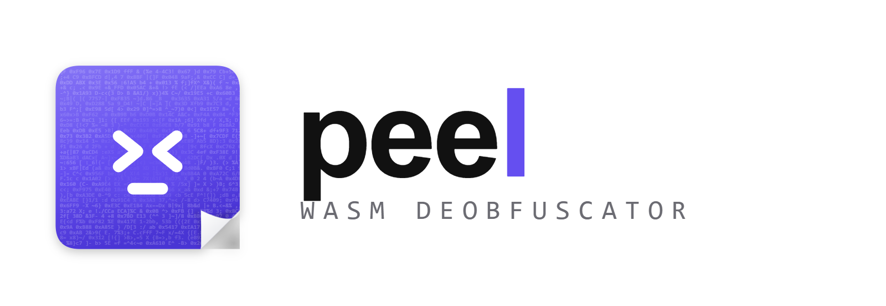
  </picture>
</p>

<p align="center">
  <b>WebAssembly'deki gizlemeyi tarayıcında soy.</b><br>
  Açık kaynak · MIT · sonsuza dek ücretsiz · modülün cihazından çıkmaz
</p>

<p align="center">
  <a href="README.md">English</a> ·
  <a href="#hızlı-başlangıç">Hızlı başlangıç</a> ·
  <a href="#neleri-geri-alır">Neleri geri alır</a> ·
  <a href="#analiz-raporu">Rapor</a> ·
  <a href="#komut-satırı">CLI</a> ·
  <a href="#kütüphane">Kütüphane</a> ·
  <a href="#nasıl-çalışır">Nasıl çalışır</a> ·
  <a href="#dürüst-sınırlar">Sınırlar</a>
</p>

<p align="center">
  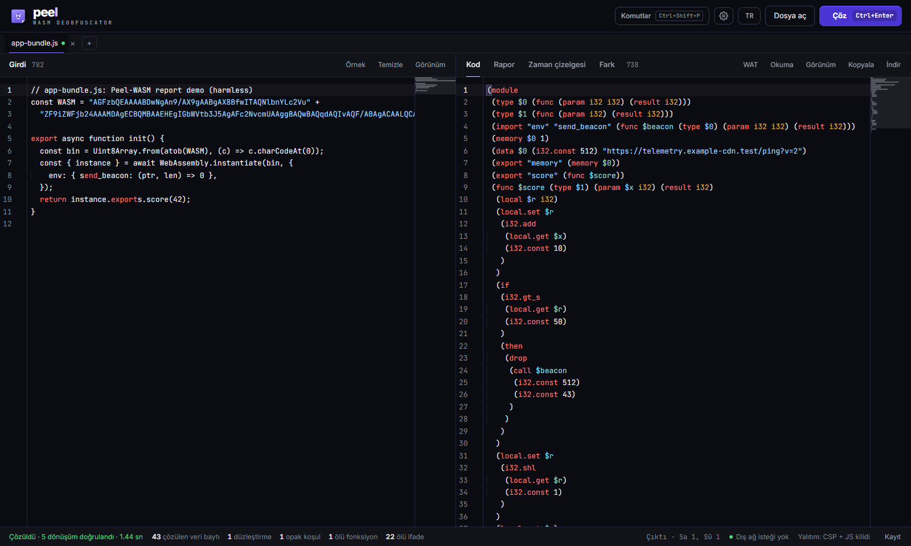
</p>

---

## PEEL nedir?

PEEL bir WebAssembly gizleme çözücü ve analiz aracıdır. Bir `.wasm` dosyası aç, WAT yapıştır ya da modülü base64 olarak
taşıyan JavaScript yükleyicisini bırak, **Çöz**'e bas (`Ctrl + Enter`): okunabilir modülü WAT ya da sözde C olarak, modülün
gerçekte ne yaptığını anlatan bir raporla birlikte alırsın.

- **Modülü güvenle çalıştırır.** Modül yalnızca sahte import'larla örneklenir: her import çağrısını ve argümanlarını (ve
  bellekte gösterdikleri dizgeleri) kaydeder, başka hiçbir şey yapmaz. Modülün erişebildiği ağ, dosya sistemi ya da JavaScript
  yoktur. Yakıt sayacı sonsuz döngüleri durdurur, bekçi kilitlenen worker'ı ya da süreci öldürür.
- **Kendi değişikliklerini kanıtlar.** Her dönüşümden sonra modül doğrulanır ve yeniden çalıştırılır. Dışa açık fonksiyonlar
  sabit argümanlarla çağrılır; herhangi bir dönüş değeri ya da tuzak, kaydedilen bir import çağrısı, bellek özeti ya da dışa
  açık bir global özgünden farklıysa dönüşüm geri alınır.
- **Modülün ne yaptığını söyler.** Araç zinciri (Emscripten, Rust / wasm-bindgen, Go, TinyGo, AssemblyScript, .NET,
  clang / wasi-sdk), kanıtlı gizleme teknikleri, kripto madenci imzaları (CryptoNight, RandomX), modülün gerçekten çağırdığı
  import'lar, konsol çıktısı, IOC'ler (URL, alan adı, IP, madencilik havuzu, Monero cüzdanı, Discord webhook) ve tehdit puanı.
- **Cihazında kalır.** Sunucu, yükleme, telemetri yok. Durum çubuğu sayfanın yaptığı her dış isteği sayar.

Tek düğme her şeyi çalıştırır.

## Kapsam

| Girdi | Nasıl işlenir |
|---|---|
| `.wasm` ikilisi | doğrudan okunur; girdi editöründe WAT olarak görünür ama çözülen dosyanın kendi baytlarıdır |
| `.wat` / `.wast` metni | binaryen ile ayrıştırılır |
| JavaScript / HTML yükleyici | gömülü modül çıkarılır: base64 (`"…" + "…"` ile bölünmüş olsa da), `data:application/wasm` adresleri, bayt dizileri (`new Uint8Array([0, 97, 115, 109, …])`), `\x00\x61…` dizgeleri ve onaltılık dizgeler; bulunan her modül katman olarak listelenir, en büyüğü çözülür |
| düz base64 | çözülür |

Çıktı: temizlenmiş modül (`.wasm`), WAT metni ve wasm-decompile tarzı sözde C görünümü.

## Hızlı başlangıç

Node.js 25 ya da daha yenisi gerekir (CLI sandbox'ı Node'un izin modelini kullanır).

```bash
git clone https://github.com/LLCForge/Peel-WASM.git
cd Peel-WASM
npm install
npm run dev
```

<http://localhost:5173> adresini aç, sayfaya bir `.wasm`, `.wat` ya da `.js` dosyası bırak veya **Örnek kodla dene**'ye tıkla,
sonra **Çöz**'e bas. İlk çalıştırma binaryen.js'i aynı kökenden yükler (yaklaşık 15 MB, sonra önbellekten).

```bash
npm run build
```

`dist/` uygulamanın tamamıdır: lisansıyla birlikte `dist/vendor/binaryen.js` ve Netlify / Cloudflare Pages için sandbox CSP'sini
içeren `_headers` dosyası dahil. İlk ziyaretten sonra PWA olarak çevrimdışı da çalışır.

## Ekran görüntüleri

<table>
  <tr>
    <td width="50%">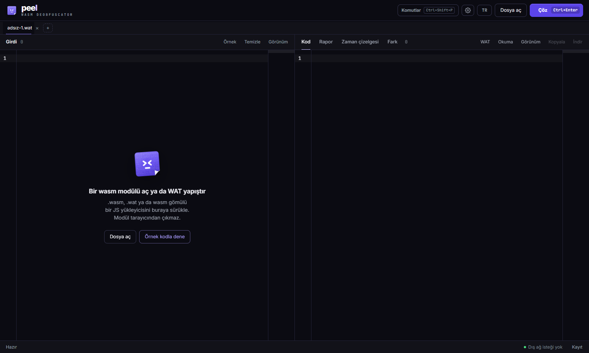<br><sub><b>Başlangıç.</b> Dosya ya da klasör aç, sürükle bırak veya örneği dene.</sub></td>
    <td width="50%">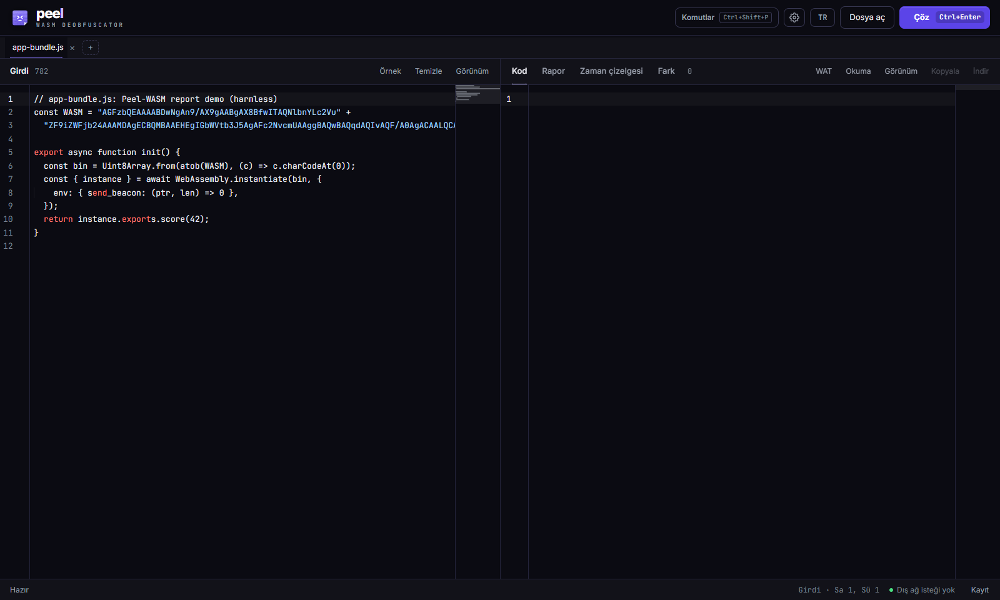<br><sub><b>Girdi.</b> Modülü base64 olarak taşıyan bir JS yükleyici.</sub></td>
  </tr>
  <tr>
    <td><br><sub><b>WAT.</b> Veri çözüldü, dağıtıcı yapılandırıldı, opak koşul ve ölü kod gitti.</sub></td>
    <td>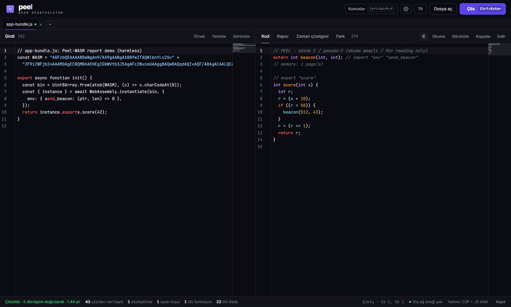<br><sub><b>Sözde C.</b> Aynı sonuç, wasm-decompile tarzı görünümde.</sub></td>
  </tr>
  <tr>
    <td>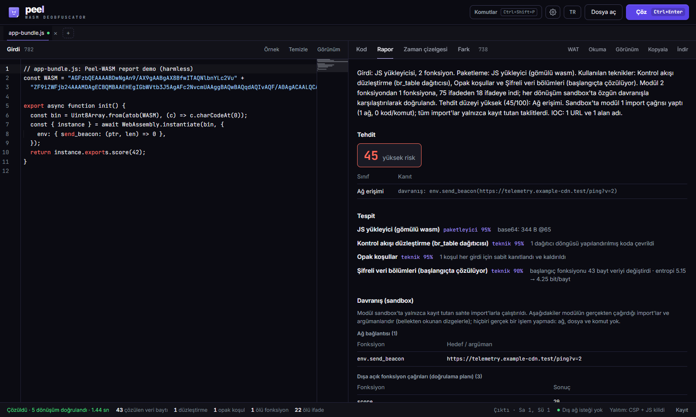<br><sub><b>Rapor.</b> Özet, tehdit, tespitler, modülün gerçekten çağırdığı import'lar, IOC, ölçümler.</sub></td>
    <td>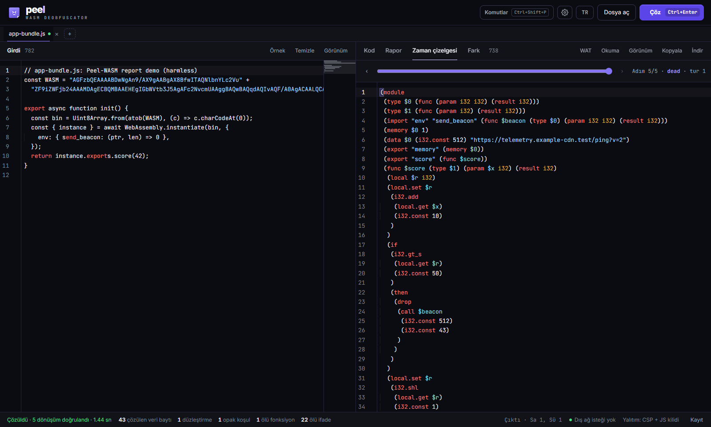<br><sub><b>Zaman çizelgesi.</b> Kabul edilen her dönüşümden sonraki modül.</sub></td>
  </tr>
  <tr>
    <td>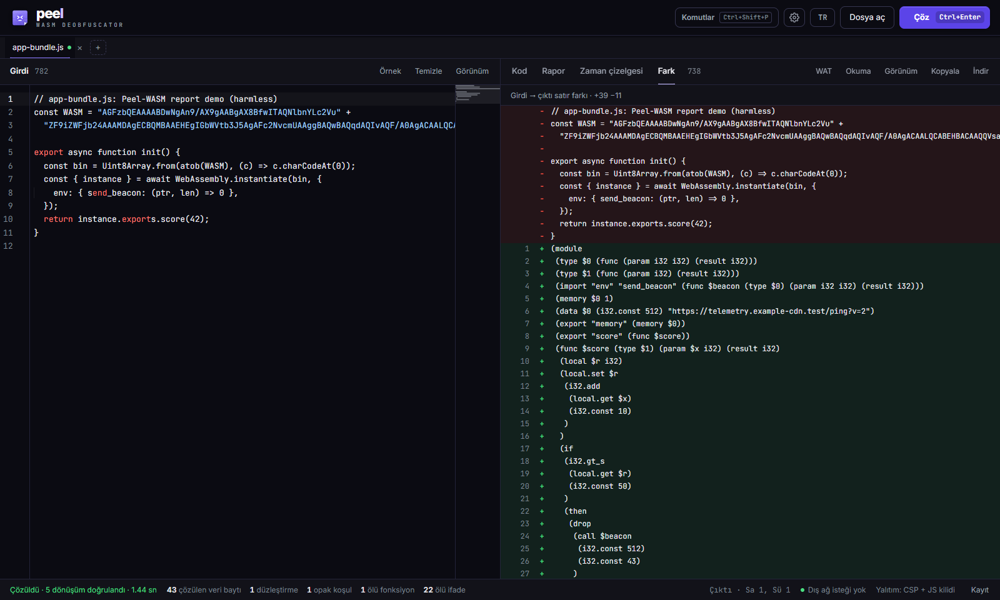<br><sub><b>Fark.</b> Girdi ve çıktı karşılaştırması.</sub></td>
    <td>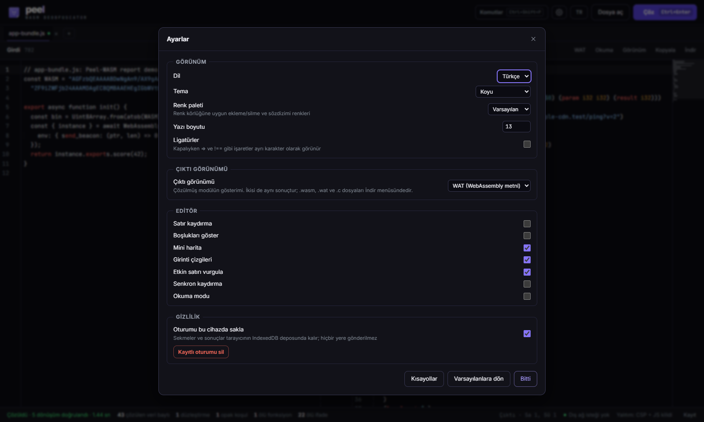<br><sub><b>Ayarlar.</b> Dil, tema, renk körlüğü paletleri, çıktı görünümü, editör ve oturum seçenekleri.</sub></td>
  </tr>
</table>

<p align="center">
  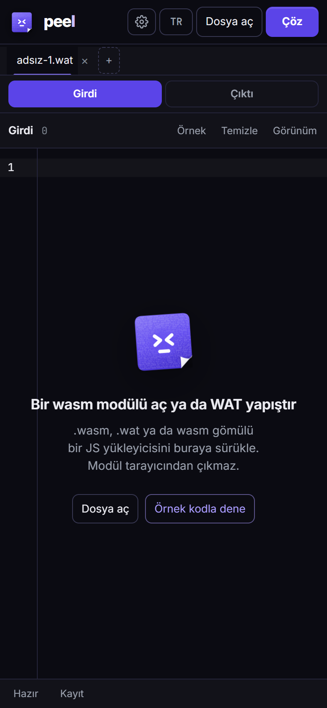<br>
  <sub>Arayüz telefonda da çalışır.</sub>
</p>

Ekran görüntülerindeki örnek zararsızdır: modülü başlangıç fonksiyonunda bir adresi çözen, bir fonksiyonu opak koşullu bir
`br_table` dağıtıcısının arkasına saklayan ve adresi `env.send_beacon` import'una veren bir JS yükleyici. Hiçbir şey
gönderilmedi: import bir kaydediciydi, çağrının raporda görünmesinin nedeni bu.

## Neleri geri alır

Aşağıdaki her dönüşüm özgün davranışla karşılaştırılır ve en küçük farkta geri alınır.

| Pass | Gizleme | Yöntem |
|---|---|---|
| `data` | diskte şifreli tutulup başlangıç fonksiyonunda çözülen veri bölümleri | modül sandbox'ta örneklenir, `start`'tan hemen sonraki bellek yeni veri bölümleri olur, `start` kaldırılır |
| `cff` | kontrol akışı düzleştirme: durum local'i üzerinde `loop` + `br_table` dağıtıcısı (`xor`/`add` ile kodlanmış durumlar dahil) | her durumun kodu ve ardılı (sabit, `select`/`if` seçimi, düşme, return, dış çıkış) okunur, graf binaryen Relooper'ı ile yapılandırılmış `if`/`loop`'a çevrilir |
| `opaque` | opak koşullar: `x*(x+1)` çifttir, `7y²-1 ≠ x²`, `(x\|1) ≠ 0`, `x² mod 4 ≠ 2` | koşulun bağlı olduğu düşük bitler üzerinde her girdi denenerek sabit olduğu kanıtlanır (add/sub/mul/shl/and/or/xor için sağlam), ölü dal silinir |
| `fold` | sabit kodlama (`i32.xor (const a) (const b)`, değişmez global'lerde saklanan sabitler) | binaryen precompute, optimize-instructions, simplify-globals |
| `dead` | işe yaramaz dallar ve hiç çağrılmayan fonksiyonlar | binaryen dce, vacuum, remove-unused-module-elements |
| `inline` | fonksiyon bölme (her biri bir kez çağrılan parçalara bölünmüş gövde) | tek çağıranı olan parçalar binaryen ile geri yerleştirilir; yalnızca parçalar modülün belirgin bir kısmıysa |
| `names` | silinmiş ad bölümü | fonksiyon ve global'ler export/import adlarından, başlangıç fonksiyonundan ve gölge yığın göstergesinden adlandırılıp gerçek bir `name` bölümüne yazılır |

Çözülmez, yalnızca raporlanır:

- **VM tabanlı koruma.** Bellekten okunan bir işlem kodunu büyük bir `br_table`'a dallandıran döngü bayt kodu yorumlayıcısı
  olarak raporlanır; başka gizlemeyle birlikteyse VM koruması olarak. Bayt kodu wasm'a geri çevrilmez; çevresindeki wasm yine
  çözülür. (Meşru bir yorumlayıcı da aynı biçimdedir; rapor bunu belirtir.)
- **Gömülü ikinci aşama modüller** (veri bölümünde ya da çalışma anında bir import'a verilen) boyutlarıyla katman olarak listelenir.

## Analiz raporu

- **Tespit** güven ve kanıtla: araç zinciri, paketleyici (JS yükleyici, gömülü modül), teknikler, kripto madenci.
- **Madenci imzaları**: Keccak tur sabitleri, AES S-kutusu / T-tabloları, CryptoNight karalama alanı maskeleri (`0x1FFFF0`,
  lite ve heavy türleri), Blake2b / Skein / Groestl sabitleri, RandomX ve madenci dizgeleri. Tek işaret yetmez; birden çoğu gerekir.
- **Davranış**: modülün sandbox'ta gerçekten çağırdığı import'lar, argümanları ve gösterdikleri dizgelerle; ağ, kod/komut, dosya
  ve diğer olarak gruplanır. WASI `fd_write` ile yazılan konsol çıktısı ve doğrulamada kullanılan dışa açık çağrıların sonuçları.
- **IOC**: URL, alan adı, IP, e-posta, `stratum+tcp://` havuzları, Monero cüzdanları, Discord webhook, Telegram botları.
- **Tehdit puanı** (0-100): cryptojacking, dinamik kod (`eval`, `emscripten_run_script`), ağ erişimi, veri sızdırma, ikinci aşama
  yükleme gibi sınıflarla.
- **Ölçümler**: boyut, önce/sonra fonksiyon ve ifade sayısı, katman, tur, geri alma.
- Türkçe ya da İngilizce tek paragraflık özet.

## Komut satırı

```bash
npx peel-wasm modul.wasm                     # WAT stdout'a, özet stderr'e
npx peel-wasm modul.wasm -o temiz.wasm --c temiz.c -r rapor.json
npx peel-wasm paket.js -f c                  # JS yükleyiciden çıkar, sözde C stdout'a
npx peel-wasm ornekler/ -d cikti/ --json --fail-on high
cat modul.wasm | npx peel-wasm - -r text
```

| Seçenek | |
|---|---|
| `-o, --out <dosya>` | sonucu yaz; biçim uzantıdan (`.wasm`, `.wat`, `.c`) |
| `--wat <dosya>`, `--c <dosya>` | WAT / sözde C'yi de yaz |
| `-f, --format wat\|c\|wasm` | stdout ve `-d` için biçim |
| `-d, --out-dir <dizin>` | `<ad>.peeled.<biçim>` dosyaları yaz; dizin girdisinde yapı korunur |
| `-r, --report json\|text\|<dosya>` | rapor stdout'a ya da dosyaya (`.txt` metin, diğerleri JSON) |
| `--only <pass,…>` | yalnızca bu pass'ler (`data, cff, opaque, fold, dead, inline, names`) |
| `--lang tr\|en` | rapor dili |
| `--fail-on low\|medium\|high\|critical` | tehdit düzeyi eşiğe ulaşınca çıkış kodu 4 |

Çıkış kodları: 0 tamam, 1 hata, 2 kullanım hatası, 4 `--fail-on` eşiğine ulaşıldı.

## Kütüphane

```js
import { peel, deobfuscate, analyze, close } from 'peel-wasm';

const r = await peel(bytes, { lang: 'tr' });   // bytes: Uint8Array (.wasm) ya da dizge (WAT / JS yükleyici)
r.bytes     // temizlenmiş modül (Uint8Array)
r.text      // WAT
r.pseudo    // sözde C
r.verified  // her dönüşüm sandbox'ta denetlendiyse true
r.report    // detection, protection, threat, behaviour, iocs, metrics, layers, summary
await close(); // paylaşılan sandbox sürecini kapat (Node)
```

`deobfuscate` raporsuz aynısıdır; `analyze` bir hat sonucundan rapor üretir. Node'da sandbox izin modeli altındaki bir alt
süreçtir, tarayıcıda Web Worker'dır (kendininkini `{ sandbox }` ile verebilirsin).

## Nasıl çalışır?

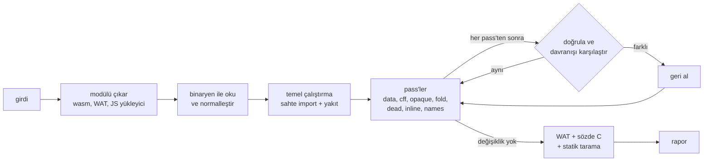

Dönüşümler binaryen IR'ı üzerinde yapılır ([binaryen.js](https://github.com/AssemblyScript/binaryen.js), Apache-2.0; editör
dışındaki tek çalışma bağımlılığı). İncelenen modül yalnızca sandbox'ta çalışır: her çalıştırmadan önce bir kopyasına yakıt
sayacı eklenir (her fonksiyon girişinde ve döngü turunda bir azalır, bitince `__peel.fuel` import'unu çağırır) ve bir çağrı planı
çıkarılır (sayısal parametreli dışa açık fonksiyonlar, her biri üç sabit argüman vektörüyle, önce başlatıcılar). Temel
çalıştırmada yakıtı biten dışa açık çağrı planı o noktada keser.

| Dizin | İçerik |
|---|---|
| `src/passes/` | 7 pass |
| `src/core/` | hat, girdi çıkarma, binaryen yardımcıları, i32 değerlendirici, yakıt ekleme, statik tarama, sözde C, rapor birleştirme |
| `src/sandbox/` | sandbox motoru (sahte import'lar, WASI taklitleri), bekçi, Node ve tarayıcı sunucuları |
| `src/report/` | tespit, tehdit analizi, IOC, özet |
| `src/ui/` | web arayüzü |
| `src/cli/`, `bin/` | CLI |
| `test/` | fixture'lar ve birim testleri |
| `scripts/` | fixture üreticisi |

## Güvenlik modeli

- **Yalnızca sahte import'lar.** Modülün dışarıya tek kapısı import'larıdır ve hepsi sıfır döndüren kaydedicidir. Birkaç WASI ve
  Emscripten taklidi (`fd_write`, `random_get`, `clock_time_get`, `proc_exit`, `memcpy`) modül çalışmayı sürdürebilsin diye
  yalnızca modülün kendi belleğine deterministik değerler yazar.
- **Node (CLI, testler, kütüphane).** Sandbox, `node --permission` ile başlatılan ve yalnızca kendi dizinini okuyabilen bir alt
  süreçtir. Dosya yazma, alt süreç, worker ve ağ işletim sistemi düzeyinde kapalıdır; test paketi bunu denetler.
- **Tarayıcı.** Sandbox Web Worker'ının kendi CSP yanıt başlığı vardır
  (`default-src 'none'; script-src 'self' 'wasm-unsafe-eval'; connect-src 'self'`) ve herhangi bir iş almadan önce `fetch`,
  `XMLHttpRequest`, `WebSocket`, `EventSource`, `WebTransport`, `importScripts`, iç içe worker, `caches`, `indexedDB`,
  `BroadcastChannel`, `eval`, `Function` kurucuları ve dizge zamanlayıcıları kaldırılır. Durum çubuğu hangi katmanların etkin
  olduğunu gösterir; başlık veremeyen barındırmalarda (GitHub Pages) yalnızca JavaScript kilidi vardır ve sayfa uyarır.
- **Yakıt ve bekçi.** Yakıt dışa açık fonksiyonlardaki döngüleri durdurur; çalıştırma başına 10 sn son tarih kilitlenen worker'ı
  ya da süreci öldürüp yeniler (ör. `start` içinde sonsuz döngü). **Durdur** her şeyi hemen keser.
- **Fixture'lar diskte kodludur** (XOR + base64): madenciye ya da yükleyiciye benzeyen örnekler antivirüsü tetiklemez.

## Dürüst sınırlar

- **Düzleştirme:** yalnızca sonraki durumu sabit, `select` ya da sabitler arasında `if` olan tek bir durum local'i üzerindeki
  `br_table` dağıtıcıları. `if` zincirleriyle kurulan, durumu bellekte ya da global'de tutan veya durumu veriden hesaplayan
  dağıtıcılar raporlanır, yeniden kurulmaz.
- **Opak koşullar:** yalnızca en çok iki local ya da global üzerinde add, sub, mul, shl, and, or, xor ve ikinin kuvveti kalanlarla
  kurulan i32 koşullar; yaygın çiftlik ve karesel kalan hilelerini kapsar. Belleğe, çağrılara ya da üst bitlere bağlı koşullara
  dokunulmaz.
- **Şifreli veri:** yalnızca başlangıç fonksiyonu çözüyorsa, bellek modülde tanımlıysa (import değilse), pasif veri bölümü yoksa ve
  `start`'tan ulaşılan kod bellekten başka bir şeye yazmıyorsa. JS yükleyicinin çağırdığı dışa açık bir başlatıcıda yapılan çözme
  geri katlanmaz.
- **VM tabanlı ve ticari korumalar** tespit edilir, raporlanır, asla çözülmez.
- **Doğrulama planın çalıştırdığını kapsar.** Sayısal parametreli dışa açık fonksiyonlar üç sabit argüman vektörüyle çağrılır;
  bu çağrıların ulaşmadığı yollar dinamik olarak denetlenmez. Statik pass'ler (binaryen optimizasyonları, kanıtlanan opak
  koşullar) yapısı gereği sağlamdır; gerisi karşılaştırmaya dayanır.
- **Sahte import'lar sıfır döndürür.** Ana makineden gerçek yanıt bekleyen bir modül (Go `wasm_exec.js` çalışma ortamı, nesne
  döndüren wasm-bindgen yapıştırıcısı) kısmen çalışır; durmadan önce yaptıkları yine kaydedilir. Başlangıç fonksiyonu
  bitemiyorsa yalnızca statik dönüşümler uygulanır ve sonuç doğrulanmamış olarak işaretlenir.
- **Sözde C okumak içindir,** derlemek için değil. SIMD, GC ve istisna komutları satır içi WAT yorumu olarak yazılır.
- **Büyük modüller:** binaryen sayfanın ana thread'inde çalışır; çok büyük modüller (onlarca MB) yavaştır ve statik tarama 1,5
  milyon ifadeden sonra durur.
- Madenci tespiti imza tabanlıdır. Keccak ve AES'i CryptoNight boyutlu bir maskeyle uygulayan temiz bir modül raporlanır;
  sabitlerini çalışma anına kadar şifreli tutan bir madenci ise çözülen veri kurtarılmadıkça yakalanmaz.

## Testler

```bash
npm test                 # 14 fixture tam hattan, ardından 6 birim test dosyası
node test/run.js cff     # adında "cff" geçen fixture'lar; log, WAT ve özetle
npm run fixtures         # test/fixtures ve src/sample.js'i yeniden üret
```

Fixture'lar ([`scripts/make-fixtures.js`](scripts/make-fixtures.js)) elle gizlenmiş zararsız modüllerdir: xor ile kodlanmış
durumlu düzleştirme, opak koşullar (tek ve iki değişkenli), şifreli veri, sabit kodlama, ölü kod, fonksiyon bölme, silinmiş ad
bölümü, JS yükleyici, madenciye benzeyen bir modül (yalnızca sabitler ve kısa bir döngü), Emscripten tarzı bir WASI programı,
ağ işareti gönderen bir modül, bayt kodu yorumlayıcısı, bitmeyen bir export, iç içe modül, Rust tarzı modül ve hiç bulgu
üretmemesi gereken temiz bir modül. Birim testleri opak koşul kanıtlayıcısını, girdi çıkarmayı ve ad bölümü yazıcısını,
sandbox'ı (izin modeli, kayıt, yakıt, bekçi, WASI taklitleri), davranışı değiştiren dönüşümlerin geri alınmasını, CLI'yi ve
çevirileri kapsar.

## Katkı

Sorun bildirimleri ve pull request'ler memnuniyetle karşılanır. PEEL'in çözemediği bir modülün varsa küçük, zararsız bir
sürümüyle bir issue aç; düzeltmeyi kanıtlayan bir fixture içeren pull request en hızlı yoldur.

## Lisans

[MIT](LICENSE). binaryen.js Apache-2.0'dır ve lisansıyla birlikte `dist/vendor/` altında gelir. Ücretli sürüm, hesap ve telemetri yok.
